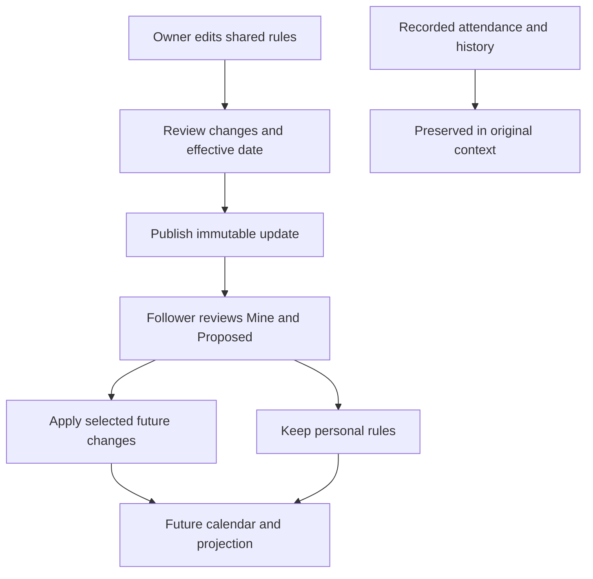

# StandIn: Full Shared Rules and Protected Attendance

Status: signed version 12 prepared for closed testing, 2026-10-25. The user confirmed
11 is the highest uploaded version. The verified 53.5 MB bundle is saved as
`releases/standin-version-12.aab`, with upload instructions in `releases/VERSION_12.md`.
It has not been uploaded to Google Play. The previous
version-11 bundle does not contain this update. Tested Firebase permissions were
deployed to standin-5755d and verified against the local rules. Full-rule publishing
remains disabled during rollout; real-device verification remains outstanding.

## Saved Implementation and Release Checks

- Recorded contributions and original units are frozen, with deliberate corrections,
  revision checks and preserved preceding edits. If legacy units conflict with the
  available rules, recover the original cached policy or keep the raw entry without
  guessing its basis; corrections wait for the original rules.
- Leave treatment, independent week-off and holiday credit, half leave and future
  plans share the calculation engine. The 18/21 example is covered by regression tests.
- Owners edit and publish complete rule packages. Their unpublished draft is saved
  privately on this device and can be discarded to reload newer shared rules.
- Followers choose Apply/Keep mine per field, with validated effective dates. Private
  edits also preview activation before saving. Existing and elapsed dates keep their
  original accepted rules; structural changes wait for compatible future periods.
- Calendar cells, entry units and projections use date-specific rules. Active rules
  refresh across midnight and app resume. Reports never combine different bases;
  incompatible combined reports display an unavailable result and explain why.
- Profile includes saved attendance and preceding corrections, plus a two-device
  conflict comparison. Both competing attendance edits are retained when resolving.
- Local database schema 4 adds protected attendance, rule caching and leave plans.
  Existing queues, calendar decisions and separate organization contexts are retained.
- Firebase permissions validate publication bounds, ownership, correction revisions
  and audit preservation. Missing/disabled `configuration/sharedRules.enabled`
  blocks full-rule publishing. The tested permissions are deployed and verified.

Final local verification: 179 app tests passed, 26 Firebase emulator tests passed,
and Flutter analysis reported no issues. Logs are in `build/resume-tests-verified.log`,
`build/resume-firestore-tests-2.log`, and `build/resume-analyze-clean.log`.
Phone and desktop previews are in `build/widget-previews/`. These are widget renders,
not a claim of real-device or production verification.

Before broad release: verify owner/follower flows on real devices and enable full
publication only with a compatible release. Version-12 preparation and deployment
logs are saved under `build/version-12-*.log`. Do not upload the earlier version-11
bundle as if it includes these changes.

## Non-Negotiable History Protection

Changing organizations, selecting another saved calendar, using custom
calculations, editing personal rules, or accepting an owner's update must never
rewrite, delete, relabel, move or silently revalue already-marked attendance.
An update also must not silently change the denominator for elapsed dates.

Only the user deliberately editing a particular attendance entry may correct its
recorded status or amounts. Show the effect before saving, keep the preceding
entry revision, and prevent a stale edit from replacing another device's edit.
There is no bulk "recalculate past attendance" action in this release.

An unchanged As of now result and an updated future Projected result are valid:
future schedules can change without altering the past.

## Owner Experience

Entry point: Profile > current organization > Shared rules. Visible to the owner
only; the public follow preview shows the latest published rules read-only.

Use one editor with sections rather than separate setup journeys:

| Section | Controls |
| --- | --- |
| Attendance target | Target percentage input |
| Calculation | Days / Hours / Sessions; full-day and half-day amounts |
| Attendance period | Weekly / Monthly / Quarterly / Semester / Academic year / Half year / Custom; required date range |
| Working schedule | Weekday toggles and Saturday pattern choices |
| Holidays | Add, rename or remove dated holidays; one holiday symbol |
| Leave | No credit / Counts toward target / Excluded from required attendance; full and half leave |
| Extra attendance | Separate toggles for week-off attendance credit and holiday attendance credit |

"Extra attendance" toggles mean credit without adding required working days.
An unmarked week-off or holiday never earns credit. A personal Make working day
action is different: it changes that date's required attendance and must not be
used as the workaround for a weekend swipe.

Saving a draft changes nothing for followers. The owner then chooses Review
changes, sees old/new values and an effective date, and chooses Publish update.
Validate values and the complete resulting rules, not just individual inputs.
Do not publish empty changes or silently overwrite a newer owner's draft.

Any attendance-rule field above can be proposed, not holidays alone. Ownership,
verification and follower counts are never editable rules. Organization renaming
is separate metadata editing and must not rename historical attendance contexts.

## Effective Dates and Periods

- Apply accepted changes prospectively, no earlier than tomorrow. If the owner
  chose a later date, use that date; a late acceptance cannot backdate the change.
- Target, leave treatment, extra attendance and schedule changes can start on a
  future date within a compatible period. Existing date contributions stay fixed.
- Basis, full/half units, period type or period-boundary changes start in the next
  calculation period. Never add hours to days or silently regroup an old report.
- If a custom period has no next period, ask for its new range before activation.
  New ranges must not overlap or move recorded dates from an existing period.
- A published historical holiday correction remains visible in the review but is
  marked "Past date - existing attendance unchanged". Do not apply it through a
  bulk update. A user may separately correct their own date deliberately.
- Preserve completed period summaries, original organization identity and unit
  labels. A live period can have a revised future projection, not revised history.
- Make future effective dates visible in the owner review, follower review and
  calendar settings. Never present a scheduled future rule as already active.

## Follower Review

Notice: "Your organization updated its rules." Review groups by calculation,
schedule, leave, extra attendance and holiday dates; show Mine and Proposed.

Each changed field or date supports Apply or Keep mine. Include Apply all and
Keep all, validate compatible combinations, and show the activation date.
If choices produce an invalid combination, explain the dependency and require a
valid choice; do not quietly change other fields to make the selection work.

Clearly identify personal overrides. Applying one replaces only that selected
override; other private edits remain untouched. Keep mine freezes the effective
value at that decision, rather than resolving it from a later shared template.
Dismissing the review leaves all decisions pending.

Owners use the same consent flow for their own personal calendar: publishing a
template is not a private-calendar edit. A new follower starts with the selected
published revision and does not review proposals published before they joined.
Later updates are reviewed in order, including later updates to declined fields.

Show one fixed message on the review: "Already-marked attendance stays unchanged."
This promise must be enforced by calculation and storage, not only this message.

## Leave and Extra Attendance Calculation

Keep physical attendance, leave credit and extra attendance distinguishable.
Leave credit is not a physical swipe. Defaults preserve existing behavior for
existing organizations; do not enable a TCS-style rule for every organization.

| Date and status | Credit toward target | Required units |
| --- | --- | --- |
| Working day, full attendance | Full units | Full units |
| Working day, qualifying full leave, Counts toward target | Full units | Full units |
| Working day, full leave, Excluded | Zero | Zero |
| Working day, full leave, No credit | Zero | Full units |
| Working day, absent | Zero | Full units |
| Week-off, attended, extra credit enabled | Attended units | Zero |
| Holiday, attended, extra credit enabled | Attended units | Zero |
| Week-off or holiday, unmarked or leave | Zero | Zero |

Half leave affects only that portion. Half attendance plus half qualifying leave
can total one full day's credit; overlapping attendance and leave cannot exceed
the full-day amount. Excluded half leave reduces required units only by that
portion. Partial attendance remains bounded by the full-day amount.

Adding a date twice, a second swipe, a sync retry or changing the active context
must never create extra credit. Extra attendance is counted within the record's
own period and organization, never carried into another organization.

For the user's example: 15 attended + 2 credited leave + 1 weekend attendance,
with 21 required working days, gives 18 / 21 = 85.71%. The weekend adds credit,
not a twenty-second working day. This is an example configuration, not a claim
that every TCS leave category qualifies.

Home shows As of now and With plans, plus the concise credit breakdown. On
hour/session-based rules use those units rather than calling every value a day.
If the allowed ratio exceeds 100%, retain the truthful ratio and credit totals;
never discard extra records to cap it. With zero required units show a neutral
"No required attendance" result, not infinity or an automatic target achievement.

Future attendance and leave use these same rules in Projected only. A planned
weekend visit may earn projected extra credit, but unplanned off-days add no
assumed credit. A changed rule can invalidate an affected plan for review; keep
the plan instead of deleting it. Plans never become actual attendance by themselves.

## Switching and Saved History

- Selecting an organization or custom calculation changes only the active view.
- Following a new organization creates a separate context. Do not copy, relabel
  or overwrite attendance from the previous organization.
- Returning to a saved context restores its accepted rules, date inputs, plans,
  periods and pending uploads. Repeated follow operations remain idempotent.
- Unfollow removes the subscription/membership as appropriate, not private history.
  Keep archived contexts accessible through Saved calendars; no Following tab.
- Global organization and legacy branch contexts remain separate. No automatic
  migration of branch attendance into a global calendar or ambiguous merging.
- Organization changes and private rule edits never change follower counts.
  Following/unfollowing membership remains the sole count-changing workflow.
- Async loaders and uploads carry a stable context ID. A response for the previous
  context must not be displayed or saved into the newly selected context.
- A missing/deleted organization must not make the user's private history unreadable.

## Storage Design

Retain existing per-user attendance IDs and organization/scope namespaces.
Additive schema migrations only; no destructive production history rewrite.

1. Immutable shared rule packages: organizations/{orgId}/ruleRevisions/{revisionId}.
   Include full policy/calendar payload, exact field/date changes, schema version,
   previous revision, author, published timestamp and proposed effective date.
   Publish package and latest pointer atomically with a stale-base check.
2. Private accepted-rule state: users/{uid}/ruleStates/{contextId}.
   Include accepted baseline, personal overrides, review checkpoint and decisions,
   plus an effective-dated rule timeline. Cache locally and synchronize through the
   existing durable queue. Sequential reviews must not skip later proposals.
3. Recorded attendance snapshot: preserve original input/status and store frozen
   physical units, credit components, required units, basis/full units, day type,
   organization/context/period IDs and rule revision used for that date.
   Summaries consume the frozen contribution before consulting live calendar rules.
4. Period context: retain evaluation range, unit basis, target and accepted timeline
   used for historical reporting. Prospective updates cannot reinterpret elapsed
   dates or completed periods. Keep unmarked elapsed-date requirements stable too.
5. Explicit attendance corrections: keep append-only preceding versions or an
   equivalent per-entry edit history. Commit input, contribution and edit revision
   together. Use a record-revision precondition for same-date concurrent edits.

Keep the original saved input separate from calculated credits. Preserve the
existing actualUnits/expectedUnits fields during migration for compatibility;
do not overload actualUnits to mean physical attendance on one screen and leave
credit on another.

Fetch only the next needed shared revision using an indexed, ordered, bounded
query; do not fetch follower lists or copy updates into every follower account.
Owner drafts are private. Follower attendance and decisions remain owner-only.

## Migration and Older Clients

The present app protects organization/scope IDs, but that alone is insufficient:
the summary consults today's calendar and can hide a recorded day after a holiday
change. Personal policy resolution can also change units used by subsequent edits.
These are implementation risks to fix before claiming history protection.

Capture the current accepted context and existing recorded inputs before enabling
new calculations. Preserve both raw stored amounts and their currently effective
contributions. For example, an existing holiday-excluded record stays excluded
after migration while its original recorded attendance remains available.
Do not reconstruct historical leave/weekend credit from newly introduced rules.
An optional explicit single-date correction can be offered later, not auto-backfilled.

Compare pre/post migration results for all existing contexts and representative
periods. If historical basis or accepted state is unavailable, keep legacy handling
and recover the missing context; do not guess, relabel units or silently migrate.

Existing immutable holiday revisions and acceptance decisions remain intact.
Bridge pending old holiday proposals into the rule-review timeline without
deleting source documents, repeating accepted updates or losing rejected dates.

New-format records cannot be downgraded or partially overwritten by an older
client. Test mixed-version reads/writes and require an app update for unsupported
edits. Old clients do not implement full-rule consent: do not pretend that a backend
publication alone gives them this protection. Feature rollout needs a compatibility
gate before owners can publish full rule packages.

## Security and Synchronization

- Creator-only public publication is enforced by Firebase; followers can modify
  only their private accepted state and attendance.
- Organization identity, date, snapshot context and the preceding record revision
  cannot change during an ordinary sync. An explicit correction must preserve the
  stable identity and atomically add its audit revision.
- Validate finite units, valid ranges, credit bounds and compatible rule choices.
  Do not allow forged follower counts, ownership transfers or verification changes.
- A snapshot/current shared revision response never overwrites pending local edits.
  Retry exact operations idempotently; rebase unrelated changes and surface conflicts.
- Recheck both proposal ID and the presented private state at acceptance time.
  A stale review cannot replace a newer private setting or decision.
- Publish does not write users' attendance, private calendars or accepted policies.
- Account deletion remains an explicit authenticated purge and covers new private
  state/edit history. Unfollowing or changing the view is never account deletion.

## Required Tests

1. TCS-style 18/21 calculation; independent week-off and holiday switches; all leave
   modes; half leave/presence combinations; no duplicate credit; zero denominator.
2. Changed holidays, weekly patterns, target, units, period and leave/extra-credit
   policy never change saved attendance or elapsed-date contributions.
3. Switching A -> B -> A, custom calculation, unfollow/refollow, archived legacy
   context and missing public organization preserve private history and queued work.
4. Full-field and per-date Apply/Keep mine, personal conflicts, invalid combinations,
   dismissal, late acceptance, future activation and sequential revision review.
5. Different bases/periods do not mix or regroup historical reports. Old records
   reopen with their original units, and explicit corrections show their effect.
6. Plans are separate, retained on invalidation and use date-effective rules;
   unchanged plans remain valid; planned leave/weekend credit never becomes actual.
7. Schema/data migration preserves raw records, effective totals, decisions,
   pending operations and version-11 contexts. Old-client overwrite denial.
8. Creator/follower security, atomic publication, idempotent sync retries,
   upload/edit races, context switching during requests and stale correction conflicts.
9. Phone layouts for the full owner editor, publication review, follower decisions,
   attendance/leave sheet and Home credit breakdown.

## Implementation Order

1. Protect recorded contributions, period/context identity and explicit edit history.
   Establish history-invariance regression tests before extending shared editing.
2. Add configurable leave and off-day credit to the single calculation engine,
   attendance sheets and planning, including frozen snapshots on new records.
3. Implement immutable full shared packages and private effective-dated acceptance.
4. Replace Holiday-only sharing with the unified owner editor and follower review.
5. Migrate existing contexts carefully; validate offline and mixed-version behavior.
6. Run full calculations, migration, UI and Firebase tests; test owner/follower
   accounts on real devices. Confirm the highest uploaded version before building
   the next closed-testing bundle. No version bump or deployment is part of design.

